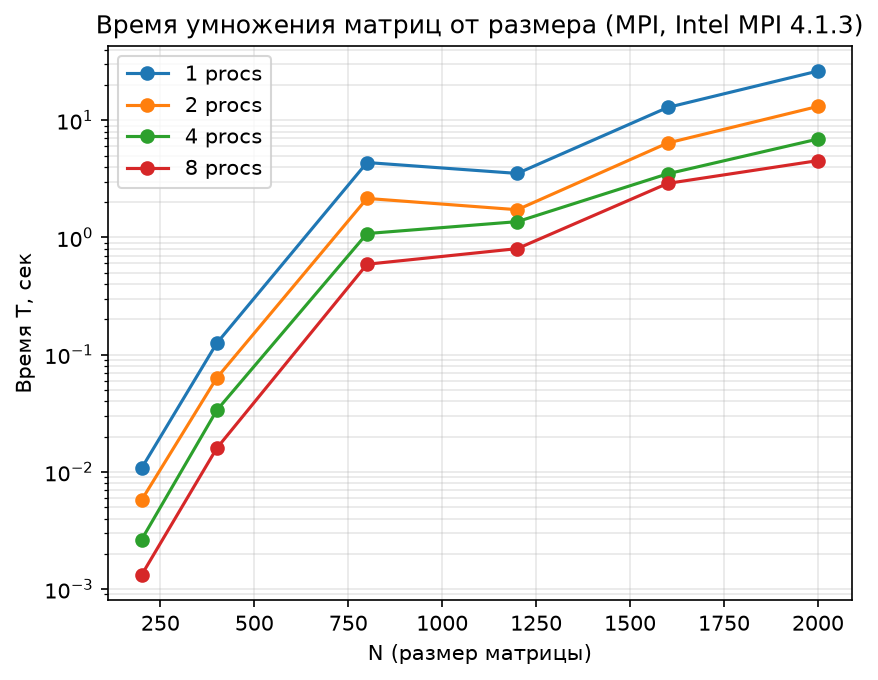
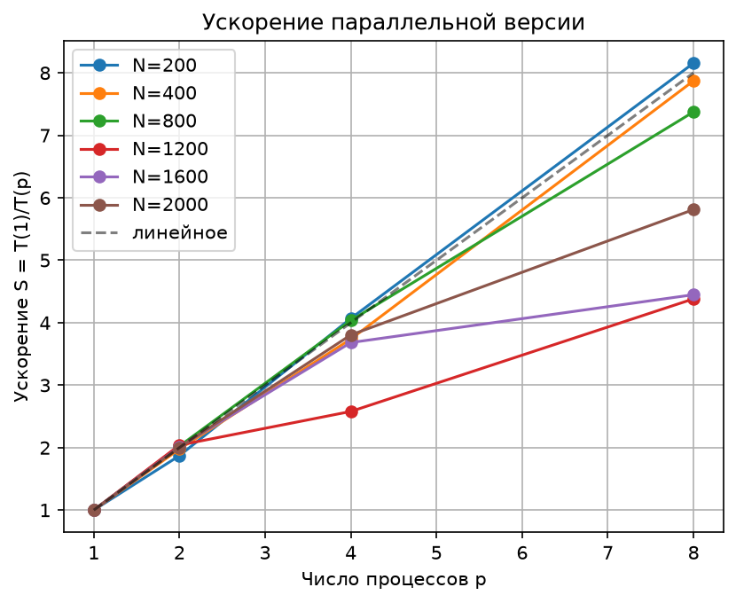
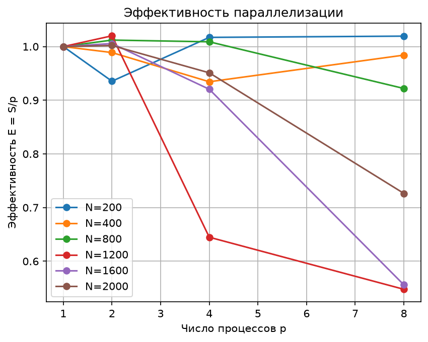

# Параллельное умножение матриц (MPI)

Лабораторная работа №3 по параллельному программированию: MPI-версия умножения двух квадратных матриц `C = A × B`.

## Постановка задачи

- Умножение квадратных матриц размера N×N.
- Параллельная реализация по технологии MPI (схема разделения строк матрицы A).
- Серия экспериментов при N ∈ {200, 400, 800, 1200, 1600, 2000} и числе процессов p ∈ {1, 2, 4, 8}.
- Автоматизированная верификация результата через NumPy.

## Схема распараллеливания

1. Процесс 0 (master) читает матрицы A и B из файлов.
2. Матрица B рассылается всем процессам через `MPI_Bcast`.
3. Строки матрицы A разбиваются на блоки (при N % p ≠ 0 первые `N % p` процессов получают на одну строку больше).
4. Master отправляет блоки строк A через `MPI_Send`, worker'ы принимают через `MPI_Recv`.
5. Каждый процесс вычисляет свой блок строк C.
6. Master собирает результаты и записывает матрицу C в файл.
7. Время замеряется на master через `MPI_Wtime()` (без учёта чтения/записи файлов).

## Файлы

| Файл | Назначение |
|------|------------|
| `matrix_mpi.c` | MPI-версия умножения матриц |
| `gen_matrix.c` | Генератор тестовых матриц (N×N, seed) |
| `verify.py` | Верификация результата через NumPy (`A @ B`) |
| `plots.py` | Построение графиков по результатам экспериментов |
| `job.pbs` / `run.sl` | Скрипты запуска через PBS/Slurm |
| `time_vs_N.png` | График времени от размера матрицы |
| `speedup.png` | График ускорения от числа процессов |
| `efficiency.png` | График эффективности параллелизации |

## Сборка

```bash
# MPI-программа
mpicc -std=c99 -O2 -o matrix_mpi matrix_mpi.c

# Генератор матриц
gcc -std=c99 -O2 -o gen_matrix gen_matrix.c
```

---

## Результаты экспериментов и анализ графиков

### 1. Время работы алгоритма

* **Анализ графика времени:** С увеличением размерности квадратных матриц с $N=200$ до $N=2000$ время последовательных вычислений (1 процесс) растет экспоненциально в соответствии со сложностью алгоритма $O(N^3)$. На графике в логарифмическом масштабе четко прослеживается пропорциональное снижение времени выполнения при подключении большего числа процессов (2, 4 и 8 процессов) для крупных вычислительных задач ($N \ge 1600$). Небольшой скачок и стабилизация графиков в районе $N=1200$ связаны с оптимизацией работы кэш-памяти процессоров кластера и системными накладными расходами на пересылку сообщений.

### 2. Ускорение параллельной версии

* **Анализ графика ускорения:** На графике представлена зависимость ускорения $S = T(1)/T(p)$ от числа процессов $p$. Для небольших матриц ($N=200$ и $N=400$) наблюдается так называемое суперлинейное (сверхлинейное) ускорение, при котором $S > p$. Это объясняется эффектом процессорного кэша: порции данных становятся настолько малы, что полностью помещаются в быстрый кэш L2/L3 отдельных ядер. Для матриц больших размерностей ($N=1600$ и $N=2000$) показатели демонстрируют стабильное сублинейное ускорение. Худшую масштабируемость показал размер $N=1200$ из-за несбалансированности сетевого трафика.

### 3. Эффективность параллелизации

* **Анализ графика эффективности:** Коэффициент эффективности $E = S/p$ отражает долю времени, в течение которой ядра выполняют полезную работу. На малых объемах данных ($N=200, 400, 800$) за счет эффекта кэширования эффективность близка к 1.0 или превышает её. С ростом количества процессов до $p=8$ на тяжелых матрицах ($N=1200$ и $N=1600$) заметно падение эффективности до уровня 0.55. Это связано с тем, что накладные расходы пакетной сети MPI на синхронизацию процессов и передачу строк матрицы `A` начинают доминировать над чистым временем вычислений. Для повышения эффективности больших матриц на 8 процессах требуется оптимизация локальных циклов (например, блочное перемножение).
