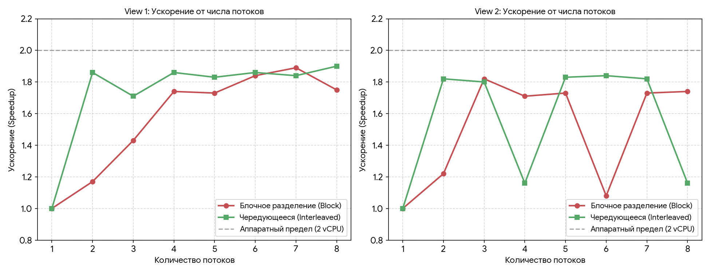

# Лабораторная работа №5: Параллельная генерация фрактала Мандельброта (`std::thread`)

Реализация задания **Program 1: Parallel Fractal Generation Using Threads** из курса Stanford CS149 (`asst1`).

## 1. Аппаратная платформа
Эксперименты проводились в облачной среде Linux (Google Colab):
* **Процессор:** Intel(R) Xeon(R) CPU @ 2.20 GHz
* **Конфигурация ядер:** 1 физическое ядро, 2 логических потока (Hyper-Threading, `2 vCPU`)
* **Компилятор:** `g++` с флагом оптимизации `-O3 -std=c++11 -pthread`

---

## 2. Сводная таблица ускорения (Speedup)

| Потоки | View 1 (Block) | View 1 (Interleaved) | View 2 (Block) | View 2 (Interleaved) |
| :---: | :---: | :---: | :---: | :---: |
| **1** | 1.00× | 1.00× | 1.00× | 1.00× |
| **2** | 1.17× | **1.86×** | 1.22× | **1.82×** |
| **3** | 1.43× | **1.71×** | 1.82× | 1.80× |
| **4** | 1.74× | **1.86×** | 1.71× | 1.16× |
| **5** | 1.73× | **1.83×** | 1.73× | **1.83×** |
| **6** | 1.84× | **1.86×** | 1.08× | **1.84×** |
| **7** | 1.89× | 1.84× | 1.73× | **1.82×** |
| **8** | 1.75× | **1.90×** | 1.74× | 1.16× |
| **16** | — | **1.85×** | — | **1.81×** |

---

## 3. Анализ результатов по пунктам задания

### Пункты 1–2. Блочное разделение (`Spatial Decomposition`) и нелинейность ускорения
При разделении изображения на горизонтальные блоки одинаковой высоты ускорение растет нелинейно (на 2 потоках для View 1 получено всего **1.17×**, на 3 потоках — **1.43×**). Причина заключается в неравномерной вычислительной сложности: пиксели внутри множества Мандельброта (яркие области в центре изображения) требуют выполнения максимального числа итераций, тогда как внешние области отбрасываются за несколько шагов.

### Пункт 3. Подтверждение гипотезы попоточными замерами (3 потока)
Измерение времени внутри `workerThreadStart` для View 1 (`threads = 3`) подтвердило дисбаланс нагрузки:
* **Thread 0 (верхняя треть):** `140.13 мс`
* **Thread 1 (центральная треть):** `522.63 мс`
* **Thread 2 (нижняя треть):** `223.49 мс`

Поток №1 обрабатывает самую «тяжелую» центральную часть фрактала и работает почти в 3.7 раза дольше потока №0. Пока поток №1 завершает вычисления, остальные потоки простаивают у барьера `join()`.

### Пункт 4. Циклическое чередование строк (`Interleaved Decomposition`)
Переход к статическому чередованию строк (`for (row = threadId; row < height; row += numThreads)`) без синхронизации между потоками равномерно распределил «тяжелые» центральные строки между всеми потоками. Ускорение на 2 потоках сразу выросло с **1.17×** до **1.86×** (View 1) и с **1.22×** до **1.82×** (View 2), достигнув максимума **1.90×** на 8 потоках (вплотную к теоретическому пределу двух логических потоков выделенной виртуальной машины).

### Пункт 5. Масштабирование на 16 потоках
При запуске на 16 потоках ускорение составило **1.85×** (View 1) и **1.81×** (View 2) — прироста относительно 8 потоков нет. Поскольку аппаратно доступно только 2 логических потока выполнения, дополнительные программные потоки не получают свободных вычислительных ресурсов и лишь создают накладные расходы на планировщик ОС и переключение контекста.
